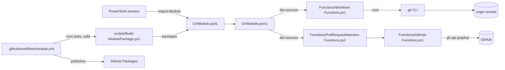

# UVModule

PowerShell module with utilities for creating and removing Git worktrees for
task, user story, bug, and pull request review work, and for finding your GitHub
pull requests that need attention.

## Table of Contents

- [Features](#features)
- [Architecture](#architecture)
- [Getting Started](#getting-started)
- [Usage](#usage)
- [Testing](#testing)
- [Project Structure](#project-structure)
- [Build and Release](#build-and-release)
- [Documentation](#documentation)

## Features

- `New-Worktree` / `Remove-Worktree` for task and user story worktrees (`feat-<id>`).
- `New-BugWorktree` / `Remove-BugWorktree` for bug worktrees (`bug-<id>`).
- `New-ReviewWorktree` / `Remove-ReviewWorktree` for PR review worktrees (`review/<branch>`).
- `Get-PullRequestWithUnresolvedThread`, `Get-ApprovedPullRequestNotMerged` and `Get-PullRequestNeedingAttention` list your open GitHub PRs with unresolved review threads, approvals awaiting merge, or both.
- `-WhatIf` previews and safety checks that refuse to delete uncommitted or unpushed work unless `-Force` is used.

## Architecture

`UVModule.psm1` is the module entry point. It dot-sources every `.ps1` file under
`Functions\`. `UVModule.psd1` is the manifest and controls which functions are
exported. Packaging is done by `scripts\Build-ModulePackage.ps1` and published by
a GitHub Actions workflow.



## Getting Started

### Prerequisites

- [PowerShell 7.0 or later](https://learn.microsoft.com/powershell/scripting/install/installing-powershell) (PowerShell Core only)
- [Git](https://git-scm.com/downloads)
- For the pull request commands: the [GitHub CLI](https://cli.github.com), signed in with `gh auth login`
- [Pester 3.4.0](https://github.com/pester/Pester) to run tests

### Install

Install from GitHub Packages (see [Installation](./docs/Installation.md) for
authentication details) or import from a checkout:

```powershell
Import-Module 'C:\path\to\powershell-module\UVModule.psm1'
```

## Usage

```powershell
New-Worktree -TaskId 12345 -BranchName add-search
Remove-Worktree -TaskId 12345 -BranchName add-search
New-BugWorktree -BugId 54321 -BranchName fix-login
New-ReviewWorktree -BranchName '12345-feature'
New-Worktree -TaskId 12345 -WhatIf | Format-List
```

See [Worktree functions](./docs/Worktree.md) for all options.

```powershell
Get-PullRequestNeedingAttention | Format-Table Number, Title, Reasons, Url
```

See [Pull request attention](./docs/PullRequestAttention.md) for options and rules.

## Testing

```powershell
Invoke-Pester .\Tests
```

The tests use temporary local Git repositories and test doubles; they do not access a real remote or GitHub.

## Project Structure

| Path | Purpose |
|---|---|
| `UVModule.psd1` | Module manifest (version, exported functions) |
| `UVModule.psm1` | Module entry point; loads `Functions\*.ps1` |
| `Functions\` | Worktree and GitHub pull request function implementations |
| `Tests\` | Pester tests and package integration test |
| `scripts\` | `Build-ModulePackage.ps1` packaging script |
| `docs\` | Installation, build/release, and worktree guides |
| `.github\workflows\` | CI workflow (`module.yml`) |

## Build and Release

Build a package without publishing (requires PSResourceGet 1.1.0 or later):

```powershell
New-Item -ItemType Directory -Path .\package -Force | Out-Null
.\scripts\Build-ModulePackage.ps1 -DestinationPath .\package
```

Releases are published by pushing a `v<version>` tag that matches
`ModuleVersion` in `UVModule.psd1`. See [Build and release](./docs/BuildRelease.md).

## Documentation

- [Installation](./docs/Installation.md)
- [Build and release](./docs/BuildRelease.md)
- [Worktree functions](./docs/Worktree.md)
- [Pull request attention](./docs/PullRequestAttention.md)
